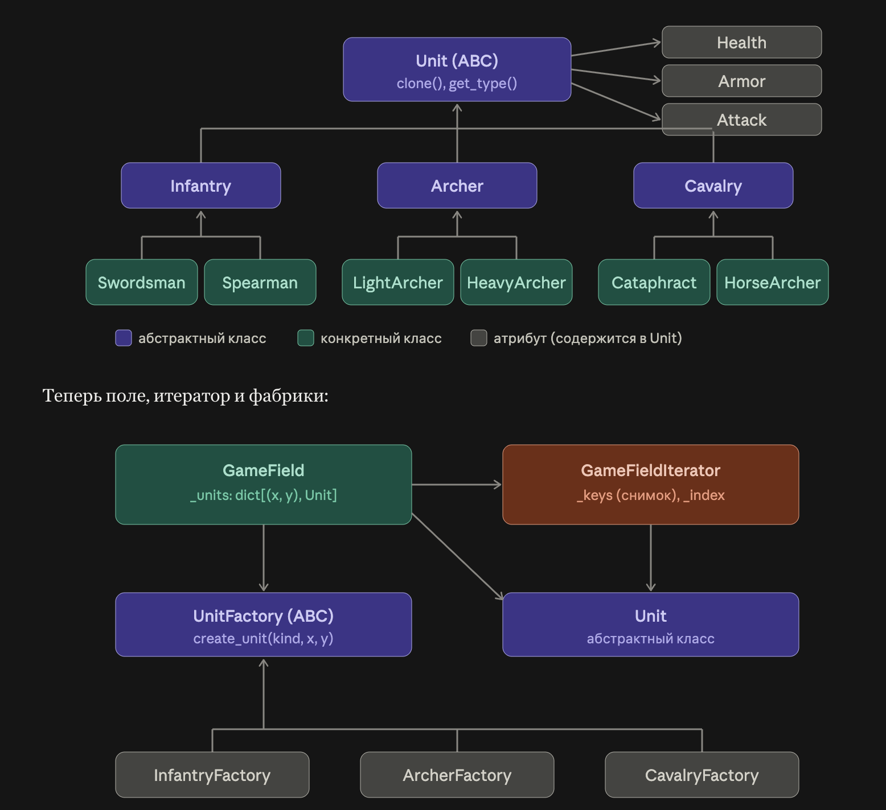
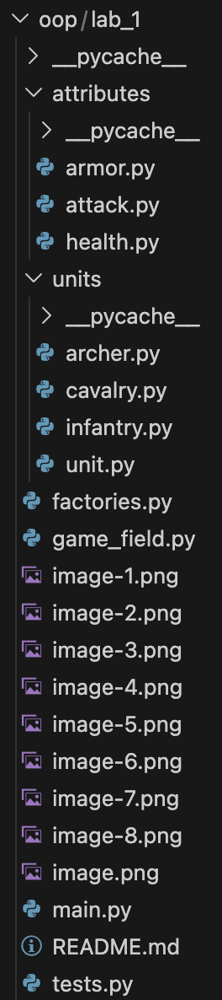
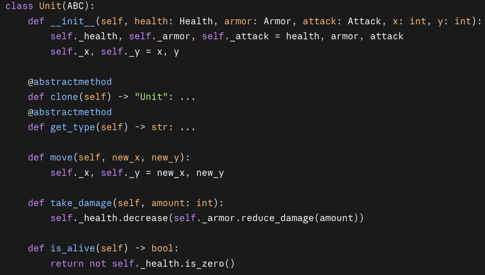
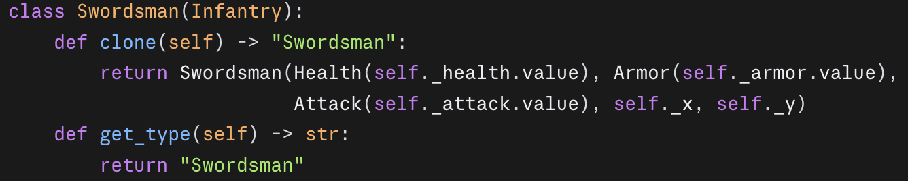
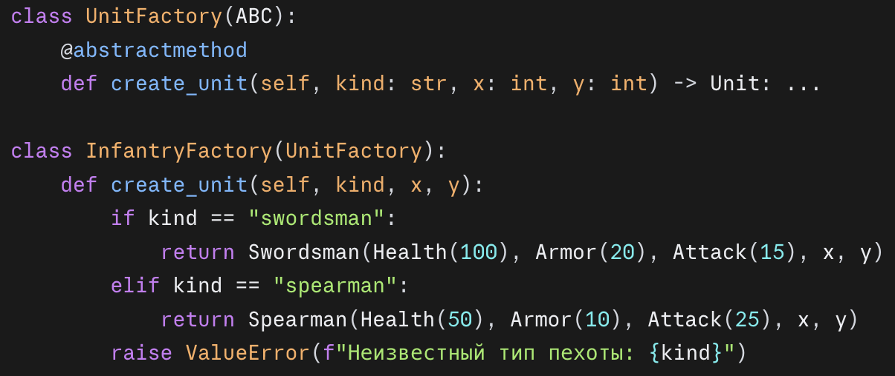
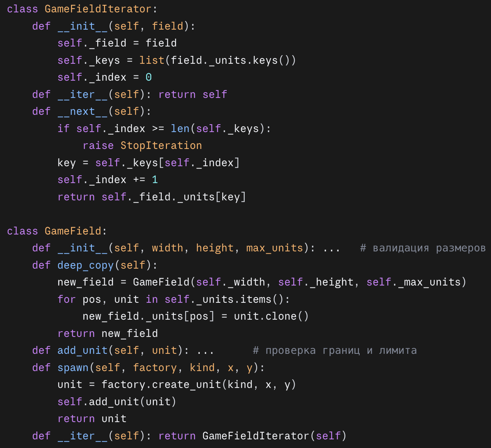
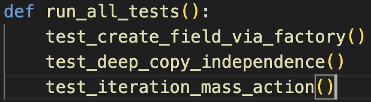
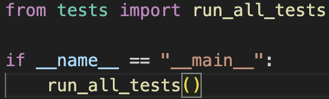
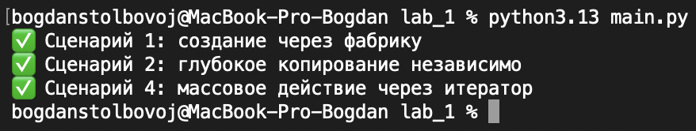
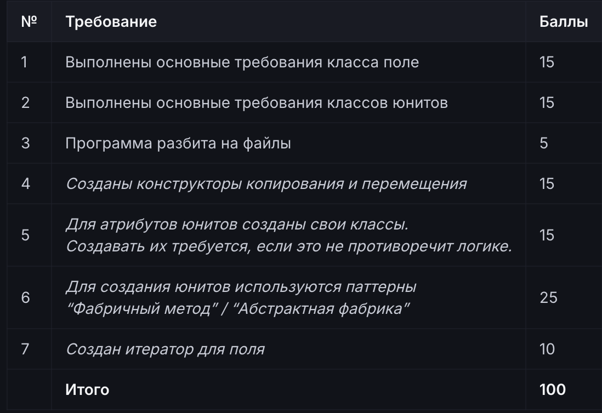

# Отчёт по проекту: ООП + паттерны проектирования

## 1. Постановка задачи
- Освоить основы ООП (классы, наследование, контейнеры) на примере разработки игры и различных юнитов.
- Реализовать паттерны «Фабричный метод» / «Абстрактная фабрика» для создания юнитов, а также итератор для обхода юнитов на игровом поле.
- Работу выполнить на ЯП python.

## 2. Архитектура решения

## 3. Обоснование выбора паттерна
- Выбран паттерн «Фабричный метод», так как в задаче отсутствует необходимость создавать согласованные семейства юнитов.
- Каждая фабрика инкапсулирует создание юнитов одного типа, что позволяет легко добавлять новые типы без изменения клиентского кода.

## 4. Структура проекта

## 5. Ключевые листинги
- Итератор:
GameField хранит юнитов в словаре {(x, y): Unit}. Метод __iter__ возвращает новый GameFieldIterator, поэтому цикл for unit in field работает как с обычной коллекцией.
* Снимок ключей. В конструкторе итератор копирует list(field._units.keys()) и запоминает _index = 0. Порядок обхода — порядок добавления юнитов.
* Шаг обхода. __next__ берёт ключ по индексу, увеличивает индекс и возвращает field._units[key]. Когда индекс выходит за длину списка, выбрасывается StopIteration.
* Независимость обходов. Каждый вызов iter(field) создаёт свой итератор со своим индексом, поэтому вложенные циклы не мешают друг другу.
* Применение. В tests.py итератор используется для массового действия: каждому из пяти юнитов наносится урон 30.

Итератор отдаёт сами объекты Unit, а не копии, поэтому изменения (take_damage) видны на поле сразу.

- unit.py:

- infantry.py — типичный конкретный юнит (остальные пять устроены так же):

- factories.py — абстрактная фабрика и одна из реализаций:

- game_field.py — итератор и поле:

## 6. Демонстрационные сценарии

## 7. Таблица соответствия критериям оценки
